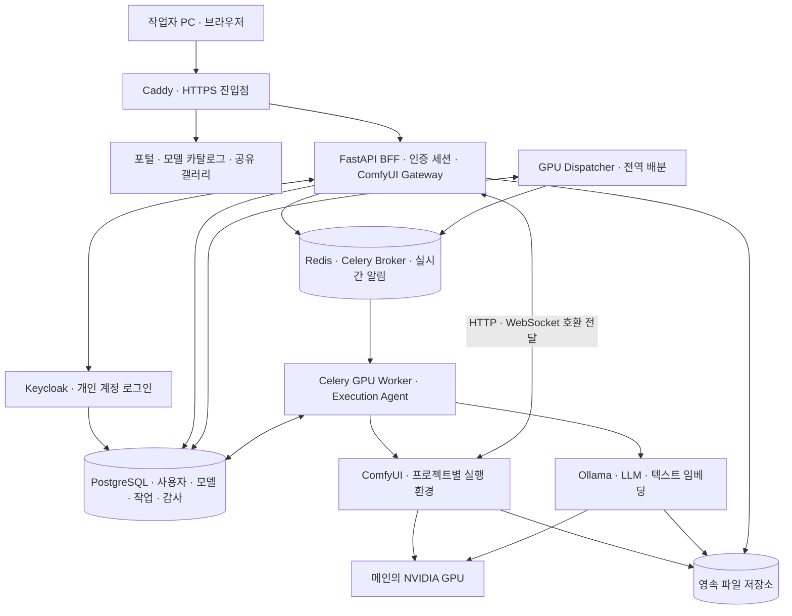

# 시스템 구조와 사용자 흐름

> 상태: 구현 전 설계. 문서의 API와 구성 요소 중 자체 개발 대상으로 표시된 부분은 아직 존재하지 않습니다.

## 1. 전체 구조



게이트웨이와 ComfyUI 사이의 연결은 편집·업로드·프리뷰·검증·상태 전달을 위한 것입니다. **실제 GPU 실행 요청은 Dispatcher가 승인한 Execution Agent만 백엔드에 전달**합니다. 다이어그램의 직접 연결을 스케줄러 우회 경로로 구현하지 않습니다.

ComfyUI 자체가 편집용 JavaScript 클라이언트와 실행용 Python 서버로 나뉘어 있으므로 이 구조를 기반으로 사용합니다. 일부 커스텀 노드는 브라우저와 서버의 직접 통신을 필요로 하므로 워크플로우 JSON을 실행하는 별도 간이 화면으로 대체하지 않습니다. [공식 클라이언트·서버 구조](https://docs.comfy.org/custom-nodes/overview)

## 2. 역할과 접근 정책

| 역할 | 기본 권한 |
| --- | --- |
| 작업자 `member` | 모델·공유 파일·팀 작업 열람, 생성 요청, 자신의 작업 취소, 공유 자료 업로드, 실험 환경 사용 |
| 관리자 `admin` | 계정·역할 관리, 전체 작업 제어, 공용 환경·모델 등록 관리, 감사 로그 조회·내보내기 |
| 서비스 계정 | 지정된 내부 API만 사용; 일반 사용자를 사칭하지 않고 원래 작업의 행위자를 별도 기록 |

- 팀은 하나의 공유 작업 공간을 사용합니다. 작성자 정보는 소유권 잠금이 아니라 이력 추적에 사용합니다.
- 공유 파일 변경·휴지통 이동도 사용자와 시간, 대상 파일을 기록합니다. 영구 삭제는 관리자 기능으로 분리합니다.
- 감사 기록은 관리자만 조회하며 일반 팀원은 팀 작업·결과물 이력을 확인합니다.
- 새 계정의 공개 셀프 가입은 초기에는 비활성화하고 관리자가 계정을 생성합니다.

## 3. 로그인과 사용자 식별

1. 사용자가 포털 또는 ComfyUI 주소를 엽니다.
2. FastAPI BFF가 Keycloak으로 리다이렉트하여 OIDC Authorization Code + PKCE 로그인을 처리합니다.
3. 콜백에서 `state`, `nonce`, 서명, issuer, audience, 유효기간을 검증합니다.
4. `(issuer, subject)`를 서비스 DB의 사용자 UUID에 연결하고 서버 측 세션을 생성합니다.
5. 브라우저에는 `HttpOnly`, `Secure`, 적절한 `SameSite` 속성의 세션 쿠키만 전달합니다. 토큰은 브라우저 localStorage에 저장하지 않습니다.
6. 변경 요청에는 CSRF 검증을 적용하고 WebSocket 연결의 Origin과 세션도 검증합니다.
7. 로그인·로그아웃·실패 이벤트와 인증된 HTTP·WebSocket 접속을 각각 기록합니다.

실패한 로그인은 인증된 사용자 ID가 없을 수 있으므로 Keycloak의 인증 이벤트를 별도 수집합니다. 성공 콜백만 기록하는 방식으로 끝내지 않습니다. 비밀번호와 비밀번호 해시는 Keycloak에 맡기고 애플리케이션 DB에 중복 저장하지 않습니다.

사용자가 입력한 `user_id`, 닉네임, `client_id`, 헤더는 행위자 식별 근거가 아닙니다. 게이트웨이가 검증한 서버 세션으로 행위자를 결정하고 외부의 사용자 식별 헤더는 제거합니다. 프록시 IP 헤더는 지정한 Caddy에서 온 경우만 신뢰합니다.

## 4. 작업자가 실제로 사용하는 과정

1. 개인 계정으로 로그인합니다.
2. 프로젝트와 공용 또는 실험 실행 환경을 선택합니다.
3. 모델 카탈로그에서 모델과 용도를 고릅니다.
4. 호환되는 예제 워크플로우를 ComfyUI에 불러옵니다.
5. 노드·프롬프트·입력 이미지·영상 등을 자유롭게 편집합니다.
6. 실행을 누르면 로그인 사용자와 함께 서비스 DB에 작업이 등록됩니다.
7. 대기 순서와 진행 상황을 화면에서 확인합니다.
8. 메인이 결과물을 저장하면 해당 브라우저에서 프리뷰를 보고 다운로드합니다.
9. 다른 팀원도 공유 갤러리에서 결과물을 확인하고 동일 워크플로우로 재사용합니다.

브라우저 종료나 일시적인 접속 끊김은 생성 작업을 취소하지 않습니다. 다시 로그인하면 자신의 작업 및 팀 결과물을 조회할 수 있습니다. 세션 만료 후 새 요청은 재로그인을 요구하며 이미 승인·실행 중인 작업은 계속됩니다. 계정 비활성화 시 아직 시작되지 않은 작업은 dispatch 단계에서 차단합니다.

## 5. 모델 카탈로그와 호환 워크플로우

### 5.1 화면에 제공할 항목

| 항목 | 예 |
| --- | --- |
| 종류 | 이미지, 영상, LLM, 텍스트 임베딩, LoRA, VAE, 인코더, 업스케일러 |
| 모델 식별 | 표시명, 버전, 파일 SHA-256 또는 실행기 manifest digest |
| 실행 방법 | ComfyUI 로더 또는 Ollama/다른 실행기 어댑터 |
| 의존 구성 | 인코더, VAE, 노드 팩 및 버전, 실행 환경 이미지 digest |
| 요구 자원 | 측정 기준 설정과 권장 VRAM, 해상도·프레임·컨텍스트 범위 |
| 설치 상태 | 미설치, 다운로드 중, 검증 중, 사용 가능, 오류 |
| 시작 방법 | 호환 예제 워크플로우 목록과 불러오기 버튼 |
| 출처 | 배포 URL, 라이선스 및 사용 조건 메모 |

### 5.2 선택 시 동작

1. 서버가 모델 버전, 대상 실행 환경, 템플릿 버전의 호환 규칙을 확인합니다.
2. 필요한 모델 파일과 커스텀 노드 설치 상태를 검사합니다.
3. 누락된 항목을 설명하고 해당 환경에 설치 작업을 등록할 수 있게 합니다.
4. 선택한 템플릿의 정해진 노드 입력에 모델을 배치합니다.
5. 템플릿을 ComfyUI 편집기에 로드하고 사용자가 수정하도록 합니다.
6. 실제 실행 전 현재 그래프를 다시 검증합니다. 처음 선택한 템플릿의 호환성이 수정한 그래프까지 보장하지는 않습니다.

호환성은 파일 확장자나 이름만으로 판단하지 않습니다. 모델 아키텍처, 로더 클래스, 텐서 형식·양자화, 인코더/VAE 조합, 노드 버전, 실행 환경과 실제 검증 결과를 사용합니다.

### 5.3 API의 의미

- 이미지·영상은 ComfyUI의 로더와 워크플로우 실행을 사용합니다.
- 지원되는 LLM·텍스트 임베딩은 Ollama API에서 모델 식별자를 선택합니다.
- Ollama 미지원 모델은 다른 실행기 어댑터를 추가합니다.
- 사용자에게는 통합 모델 목록과 작업 API를 제공하고 내부 실행기로 라우팅합니다.
- 모델 파일별로 독립적인 서버 포트나 API 프로세스를 하나씩 만들지 않습니다.
- textual inversion 임베딩은 텍스트 검색·RAG용 임베딩과 별도 유형으로 관리합니다.

## 6. ComfyUI 원래 기능을 유지하는 통합

ComfyUI의 프런트엔드를 그대로 제공하고 모델 카탈로그·로그인 표시·전역 큐 패널을 확장으로 추가합니다. 자체 개발 게이트웨이는 다음 범위를 처리합니다.

| 경로 / 기능 | 처리 원칙 |
| --- | --- |
| `/prompt` 제출 | 인증, 검증, 작업 DB 등록 후 전역 스케줄러로 전달 |
| `/ws` 및 바이너리 프리뷰 | 세션별 연결 매핑, 진행 이벤트 전달, 재접속 처리 |
| `/queue`, `/history` 및 버전별 작업 API | 전역 작업 DB와 백엔드 상태를 일관되게 변환 |
| `/interrupt`, 큐 삭제, 메모리 해제 | 사용자 권한·작업 ID 검사 후 대상 실행기에만 전달 |
| 업로드·`/view`·파일 다운로드 | 인증 및 공유 파일 정책 적용, 업로드자·열람자 기록 |
| `/object_info`, 모델 목록, 확장 파일 | 선택한 실행 환경의 실제 목록 반환 |
| `/userdata`와 워크플로우 저장 | 로그인 사용자별 편집 설정과 팀 공유 워크플로우를 구분 |
| 커스텀 노드의 추가 HTTP/WS 경로 | 경로 목록 조사, 인증 유지, GPU 부작용·모델 접근 여부별 어댑터 적용 |

원본 API 경로는 공식 문서와 **고정할 ComfyUI 버전의 소스**를 함께 확인합니다. 새 작업 API나 확장 실행 경로가 추가되면 우회 제출이 되지 않도록 계약 검증을 갱신합니다. [공식 서버 API](https://docs.comfy.org/development/comfyui-server/comms_routes)

프로젝트별 서브도메인을 기본으로 사용하여 확장의 절대 경로·WebSocket 주소 충돌을 줄입니다. 포털과 각 편집기 호스트는 동일한 Keycloak SSO를 사용하되 각 호스트가 자신의 세션을 발급합니다. 인증 갱신이나 재접속 후에도 다른 사용자의 연결 ID를 재사용하지 않습니다.

## 7. 커스텀 노드와 실행 환경

- 공용 환경은 검증한 노드·패키지 조합을 고정합니다.
- 실험 환경은 작업자/프로젝트별로 분리하여 새 노드와 확장을 설치합니다.
- 모델 파일은 기본 읽기 전용으로 공유하고 코드·패키지·설정은 환경별로 분리합니다.
- 설치·업데이트는 사용 중인 환경에 즉시 적용하지 않고 drain 후 수행합니다. 이미지 또는 환경 revision을 새로 만들고 실행 기록에 남깁니다.
- Manager의 원격 설치 허용 정책은 해당 버전 기준으로 설정합니다. 무조건 전체 제한을 해제하는 구성을 기본값으로 삼지 않습니다.
- 커스텀 노드는 서버 코드를 실행하므로 서비스 DB 비밀번호·관리자 토큰·Docker 소켓을 노드 컨테이너에 제공하지 않습니다.
- 환경 관리 에이전트가 고정된 이미지·볼륨·GPU 규칙으로만 컨테이너를 제어합니다. 브라우저가 임의 Docker 옵션을 전달하게 하지 않습니다.

임의의 커스텀 노드가 스케줄러 밖에서 GPU를 사용하거나 자체 모델을 다운로드할 수 있습니다. 정식 운영 환경에는 실행 경로·모델 추적 어댑터를 연결하고, 미검증 실험은 별도 표시 및 배타 실행합니다. 자유 설치와 모든 노드의 완전한 추적·호환성을 동시에 자동 보장하지 않습니다.

## 8. 공유 저장소

논리 경로는 컨테이너 기준 `/data`로 통일하고 실제 호스트 경로는 배포 설정으로 주입합니다.

```text
/data/
  models/                 # 모델별·버전별 불변 파일; 운영 환경은 읽기 전용
  staging/                # 다운로드 임시 파일; 검증 완료 후 모델 등록
  inputs/<project-id>/    # 업로드한 원본과 자산 ID
  outputs/<project-id>/<job-id>/<attempt-id>/
  workflows/              # 팀 공유 워크플로우 원본·실행 스냅샷
  environments/           # 환경 revision·노드 목록·잠금 파일
  thumbnails/             # 재생성 가능한 프리뷰
  backups/                # 로컬 임시 백업; 별도 매체 복사 필요
```

결과 파일은 생성 중 상태와 게시 완료 상태를 나눕니다. 저장 노드별 출력 위치를 수집하고 완료된 파일의 체크섬·크기·MIME·생성자를 DB에 등록한 뒤 갤러리에 게시합니다. 모든 파일은 서버가 해석한 자산 ID로 접근하며 사용자가 보낸 경로를 그대로 파일시스템 경로로 사용하지 않습니다.

웹 갤러리는 로그인 사용자가 공유 자료를 열람·다운로드·재사용하는 기본 통로입니다. 비디오 Range 요청도 지원합니다. Samba는 후속 선택 기능이며 도입 시 개인별 SMB 인증과 파일 접근 감사, 서비스 사용자 연결을 별도로 구현해야 합니다. Keycloak OIDC 로그인이 Samba에 자동 적용되지는 않으므로 초기에는 비인증 공유 폴더를 열지 않습니다.

## 9. 접속 범위와 이식성

초기에는 내부 DNS, 고정 서버 주소, HTTPS 인증서를 구성하고 사무실 대역에서만 접근하도록 합니다. Caddy 이외에 ComfyUI, Ollama, PostgreSQL, Redis의 호스트 포트는 공개하지 않습니다. Docker의 포트 전달과 호스트 방화벽을 함께 검증합니다.

Docker 이전에는 이미지, 설정, 비밀값, PostgreSQL 백업과 영속 파일을 함께 옮겨야 합니다. 다른 서버도 호환 GPU·드라이버·NVIDIA Container Toolkit을 갖춰야 하며 CPU 아키텍처·CUDA·PyTorch·커스텀 노드 호환성 검증이 필요합니다. 다른 장소에서의 원격 접속은 추후 VPN과 인증 정책으로 별도 설계합니다.
