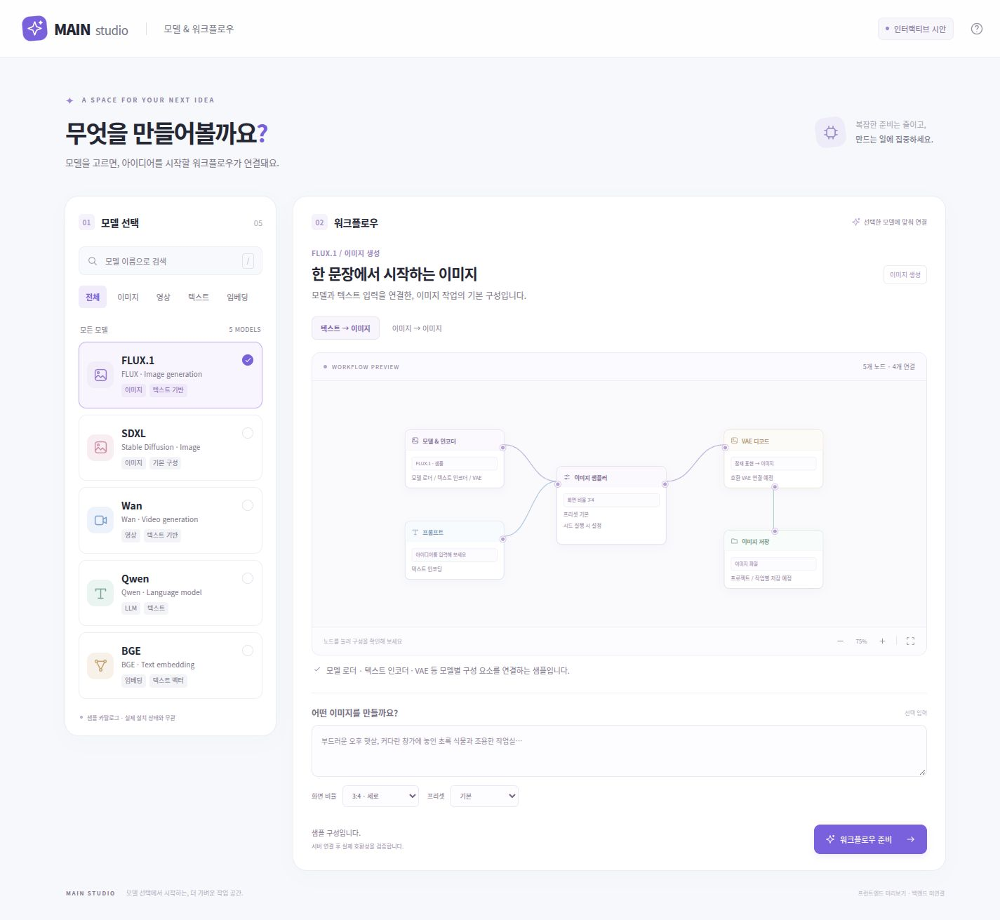

# MAIN Studio 프런트엔드 시안

모델 선택과 관련 워크플로우만 보여주는 **로그인 후 진입 화면**의 HTML·CSS·JavaScript 준비 코드입니다. 프레임워크·외부 폰트·CDN·빌드 도구 없이 열 수 있습니다.

## 화면과 동작

- 밝은 배경, 보라색 포인트, 여백을 사용한 두 열 구성입니다.
- 왼쪽은 모델 검색과 이미지·영상·텍스트·임베딩 필터입니다.
- 오른쪽은 선택 모델에 연결된 템플릿, 노드 그래프, 입력과 간단한 설정입니다.
- 모델/템플릿을 바꾸면 해당 구성만 표시합니다. 현재 검색으로 모델이 숨겨져도 선택 중인 구성은 유지됩니다.
- 노드를 클릭하면 그 구성 요소의 설명을 확인합니다.
- 확대·축소·화면 맞춤, 키보드 `/` 검색 포커스, 모달의 Escape 닫기를 지원합니다.
- 워크플로우 준비 후 설정 JSON을 다운로드할 수 있습니다.
- 모바일에서는 모델 목록과 워크플로우가 세로로 배치됩니다. 작은 화면의 그래프는 내부 스크롤·확대로 확인합니다.

별도 대시보드·접속 로그·사용자 관리 메뉴는 이 화면에 넣지 않았습니다. 운영자 화면과 전체 ComfyUI 편집기는 후속 통합 대상으로 유지합니다.

## 미리보기



`index.html`을 브라우저에서 직접 열면 됩니다. 로컬 HTTP 미리보기가 필요한 경우 이 폴더에서 다음 명령을 사용할 수 있습니다.

```bash
python3 -m http.server 8765 --bind 127.0.0.1
```

브라우저에서 `http://127.0.0.1:8765`를 엽니다. 이 명령은 정적 파일 확인용이며 로그인 서버, DB, ComfyUI 또는 GPU 서비스를 실행하지 않습니다. 이번 작업에서도 임시 정적 미리보기만 사용하고 종료합니다.

## 파일

| 파일 | 역할 |
| --- | --- |
| `index.html` | 접근 가능한 화면 구조, SVG 아이콘, 도움말/준비 모달 |
| `styles.css` | 반응형 레이아웃·색상·포커스·모션 감소 설정 |
| `catalog.js` | 실제 설치 목록과 구분된 샘플 모델·템플릿 메타데이터 |
| `workflow.js` | 모델/템플릿 검증, 허용 설정 처리, 시안 그래프 조립, 검색 |
| `app.js` | 화면 상태, 입력, 모델/템플릿 선택, SVG 연결선, JSON 다운로드 |
| `favicon.svg`, `preview.png` | 로고 아이콘과 실제 브라우저에서 캡처한 시안 |
| `tests/workflow.test.cjs` | 그래프 연결성, 잘못된 조합·설정, 유형별 구분, 검색 검증 |

## 실제 서비스와의 경계

FLUX.1, SDXL, Wan, Qwen, BGE 이름은 화면 구성용 샘플입니다. 실제 모델 설치 여부, 모델 버전, 라이선스, 호환 로더·노드, 권장 자원 또는 실행 가능성을 나타내지 않습니다. 예시 그래프는 구조를 설명하는 개념도이며 실행용 ComfyUI 노드 클래스와 같지 않습니다.

다운로드 형식은 `main.studio.workflow-draft.v1`입니다. `demo: true`, `executable: false`, `compatibility: unverified`를 포함하며 **ComfyUI에 가져와 바로 실행하는 workflow/API graph가 아닙니다.** 로그인, DB, 설치, 실제 파일 업로드, GPU 작업 제출은 연결하지 않았습니다. 생성 결과나 가짜 작업 대기열을 표시하지 않습니다.

브라우저 localStorage에는 선택한 샘플 모델·템플릿 ID만 저장합니다. 프롬프트와 설정은 현재 페이지의 메모리에만 보관하며 새로고침하면 사라집니다. 사용자 입력은 `textContent`와 폼 값으로 표시하고 HTML로 삽입하지 않습니다. 인증 정보·토큰·실제 사용자 ID를 샘플로 넣지 않습니다.

## 백엔드 연결 순서

1. Keycloak + FastAPI BFF의 로그인 후 이 화면을 제공합니다. 브라우저에 사용자 ID를 직접 지정하는 기능은 추가하지 않습니다.
2. `catalog.js` fixture를 인증된 `GET /api/models`와 모델별 템플릿 API로 대체합니다. 목록에는 불변 모델 버전·템플릿 revision·실제 설치 상태·환경 호환 결과를 포함합니다.
3. 로컬 `createDraft()`를 서버 측 workflow 준비 API에 연결합니다. API 경로는 별도 확정하며 모델 버전·템플릿 revision·환경 revision·입력 자산 ID·설정을 전달합니다. 현재 제안된 서비스 API의 구현 여부를 확인해야 합니다.
4. 서버가 승인한 바인딩으로 실제 로더·인코더·VAE·노드를 구성합니다. 로컬 descriptor를 신뢰해 임의 실행 graph로 전환하지 않습니다.
5. 준비 완료 후 ‘ComfyUI에서 자세히 편집’으로 원래 편집기에 실제 workflow를 전달합니다. 이 간단한 진입 화면이 전체 ComfyUI 기능을 제한하지 않게 합니다.
6. 실제 생성 버튼은 인증된 작업 API와 전역 GPU 스케줄러를 사용합니다. 사용자·작업·모델 감사 기록은 서버가 결정합니다.

DB/인증/스케줄러 상세는 [시스템 설계](../docs/ARCHITECTURE.md), [데이터 모델](../docs/DATA_MODEL.md), [GPU 스케줄러](../docs/GPU_SCHEDULER.md)를 따릅니다. 운영 시에는 React·TypeScript로 옮기거나 이 모듈을 확장할 수 있으며 현재 시안은 순수 HTML·CSS·JavaScript로 유지합니다.

## 검증

Node.js의 기본 테스트 러너만 사용합니다. 별도 패키지 설치는 필요하지 않습니다. 저장소 루트에서 실행합니다.

```bash
node --test frontend/tests/workflow.test.cjs
node --check frontend/catalog.js
node --check frontend/workflow.js
node --check frontend/app.js
```

브라우저에서는 모델·분류·템플릿 전환, 빈 검색, 노드 설명, 프롬프트·설정 변경, JSON 저장, 모달 키보드 동작과 데스크톱/모바일 넘침을 확인합니다. 실제 모델 생성 성능과 백엔드 통합 검증은 후속 개발 범위입니다.

2026-10-22 검증: Node 기본 테스트 8개 통과. 브라우저에서 분류·템플릿 전환, 참조 이미지 노드 추가, 입력 문자열의 HTML 비삽입, 설정 변경, 빈 검색 초기화, JSON 파일 다운로드·내용, Escape 모달 닫기, 노드 설명을 확인했습니다. 1440px 데스크톱과 390px·320px 모바일의 페이지 가로 넘침을 확인했고 검사 중 브라우저 JavaScript 오류는 없었습니다.
